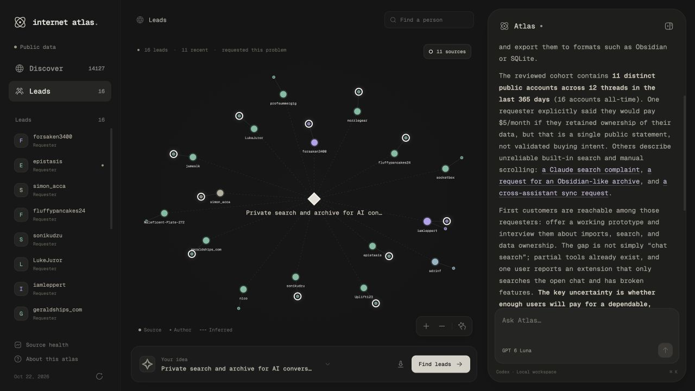

# Internet Atlas

Find repeated customer workflows in public requests, develop a product thesis and reach the people who asked for it.

Two linked graphs share one Codex agent. The app runs on your computer at **http://localhost:3000**.



[Demo sequence and judge questions](docs/demo-runbook.txt)

## Run

Requires Node 22+ and the Codex CLI, signed in with your ChatGPT account.

```sh
npm install
codex login
npm run dev
```

Open http://localhost:3000. The agent connects automatically. Use **Connect Codex** to retry if needed. Every model turn uses **GPT 6 Luna**, enforced in the backend. No OpenAI API key is required. Tested with Codex CLI 0.163.0 and its experimental dynamic tool protocol.

```sh
npm test
npm run build
npm start
```

`npm start` serves the production build. Stop a running dev server before starting it on the same port. Optional environment settings are in [.env.example](.env.example). Keep credentials in `.env.local`, which is ignored by Git.

## Use

1. Open **Requests** to inspect problems, requester counts, tiers and original quotes. Toggle **365d / All time** to explore historical demand with its original dates. Use **Topics** or search to explore the wider corpus. Select a source to read its author, date and original post. Bookmark problems in **Saved** without replacing your active idea.
2. Ask Atlas to investigate a problem or collect more requests for a specific need. Nodes pulse each time Atlas reads or cites them. The final citations stay outlined in white, and the graph frames them together.
3. Choose **Use in idea**, then **Find leads**. The **Leads** sidebar opens the second graph. It connects the idea to the people who made those requests and their original evidence. You can also create your own idea.
4. Check a public profile, then draft a DM or email. Generation applies the bundled `$unslop` skill, uses one source detail and asks one clear question. DMs target 30 to 50 words; emails target 40 to 70. Edit, save, copy or export the result. The app has no send endpoint.

Business discovery compares recurring customer jobs before recommending a product. It separates standalone opportunities from features and isolated fixes, reads a requester cohort and checks original posts, alternatives and workarounds. The final graph highlights the full distinct-account cohort supporting the demand count. **Use this idea** carries the product thesis and its exact problem into the editor, then the requester graph. Requests establish a reason to start a conversation, not validated customers.

The same agent stays with both graphs. It reads sources and request groups, collects requests from free public sources, rebuilds problems, focuses evidence, saves ideas, finds leads, checks public profiles and saves drafts. Responses come from GPT 6 Luna. Provider errors and partial coverage remain visible; the model can be stopped.

Editing the idea invalidates previous leads and drafts. Drafts are tied to the current idea revision. Saved research can be exported as Markdown. Source health distinguishes cached data, imported archives, unavailable sources and failed collection attempts. Diagnostics can be copied from that panel.

## Public data and cost

The October 22, 2026 collection contains **14,127 public records** from HN, Reddit, GitHub, Software Recommendations and X. **Source health** shows analyzed and pending posts, quote-backed requests, problem counts, 10+ audited current groups and provider failures. The app opens the cached snapshot without fetching fresh sources. Coverage is a sample, not a census of the internet. There are 2,280 quote-backed requests. Two reviewed cohorts reach 10+ recent public accounts: phone-based coding-agent work (12) and retrieving past AI conversations (11). Candidate posts stay outside demand counts until classification validates the author's own request and literal quote. The remaining 614 pending candidates do not contribute to demand.

| Source | Use | Access |
| --- | --- | --- |
| [HN Algolia API](https://hn.algolia.com/api) | Public asks, comments and original discussion links | Free, no key |
| [Hacker News API](https://github.com/HackerNews/API) | Public bios and source rechecks | Free, no key |
| [GitHub REST API](https://docs.github.com/en/rest) | Public feature requests, selected comments and profiles | Free, 60 ordinary requests/hour without a token; optional `GITHUB_TOKEN` increases limits; search is separately limited |
| [Reddit RSS](https://support.reddithelp.com/hc/en-us/articles/54353370049684-Changelog-October-8-2026) | Public subreddit search feeds | Currently no key; RSS ends November 13, 2026; new API access requests close October 31 |
| [Stack Exchange API](https://api.stackexchange.com/docs) | Software Recommendations questions with attribution and license information | Provider quotas and access controls apply; failures surface as unavailable coverage |
| [Arctic Shift](https://github.com/ArthurHeitmann/arctic_shift) | Attributed public Reddit archive posts | Free public API, original dates, partial coverage after query timeouts |
| [Community Archive](https://www.community-archive.org/docs) | Recent original X posts from consenting archive accounts | Free daily public export. A small opt-in sample, separate from the paid X API |
| [LocalLLaMA research sample](https://huggingface.co/datasets/mashu-data/reddit-comments-sample) | Attributed Reddit posts and comments | Noncommercial research license retained per record |
| [Codex app-server](https://developers.openai.com/codex/app-server) | The local agent, using managed ChatGPT authentication | Uses your existing subscription and its usage limits |

No additional paid data or embedding service is required. The local MiniLM model is downloaded on first analysis and cached for reuse. GPT 6 Luna extracts and reviews problems through your existing Codex subscription. Bulk analysis consumes subscription usage and can take several minutes. Results are cached by source content, metadata, model and prompt version. Refreshes are paced and preserve previous records when a source fails.

```sh
# Collect across eight workflow families, or provide repeated --query flags.
npm run collect -- --query 'webhook reliability' --pages 2
# Resume missing classifications, review groups and rebuild the seed.
npm run understand -- --max-new 2000 --concurrency 3
# Populate only the classification cache without changing the seed.
npm run understand -- --cache-only --max-new 200
# Warm the local node index. The app also starts this in the background.
npm run index:nodes -- --query 'search old AI conversations'
```

`npm run ingest` refreshes the wider curated sources and analyzes them. `npm run analyze` reanalyzes the cached corpus. Pending or rejected model output is excluded from reviewed demand. Cached work survives a failed run. Do not run two indexers against the same workspace at once. `ATLAS_DIRECTORY` and `PORT` let you run an isolated QA workspace without modifying your saved research. Bulk analysis supports `--input`, `--output`, `--batch-size 10..50`, `--max-new 0..15000` and `--concurrency 1..6`. Keep one indexer per workspace. `npm run expand` and `npm run datasets` write staging files; see the data-source guide before importing or replacing dataset records. `npm run eval:scope` consumes subscription allowance to check eight real scope-regression cases with GPT 6 Luna.

X coverage comes from a consent-managed public dataset, not live X search. No paid data calls or LinkedIn dump are used. Reddit includes public RSS, archive API results and a noncommercial research sample. Traceable external post datasets can be imported with `npm run import`. See [data sources and the import CLI](docs/data-sources.md) for exact flags, required author/post/date/text fields, dataset provenance and license requirements. Profile dumps and synthetic records are not request evidence.

Sources retain their original URLs, public usernames, dates and retrieval timestamps. Text remains attributable to its original authors. Public profiles may contain self-reported affiliations or email addresses. The app never infers an email from a name or domain.

## How the graph works

Explicit ask rules retrieve candidate posts. GPT 6 Luna separates requests from promotions, advice, discussion, endorsements and resolved problems. For each request it extracts the audience, workflow, problem, desired outcome and a literal supporting quote. Validation rejects invented quotes, unsupported claims and unavailable evidence. Local embeddings of those problem descriptions retrieve potential matches. Validated standalone asks remain indexed. A model pass reviews candidate matches, merging paraphrases and splitting requests that need different solutions. A second neighborhood pass revisits related problems across review-batch boundaries. A global pass compares the complete request inventory by customer workflow, pain and desired result, then retrieves matching sources across the corpus. Implementation preferences do not split a shared customer job. Every group with two or more accounts receives an independent, per-source membership audit in real model runs. That audit hides counts, tiers, account names and dates from the model. Every retained member must support the same workflow, problem and outcome with at least 0.8 confidence. Rejected members remain separate when their own need is valid. Group membership remains an inference, backed by inspectable quotes. Versioned, source-hash-bound evidence reviews correct known mistakes without removing valid requests from the atlas. Changed sources or canonical meanings invalidate those decisions and require review.

Tiers count distinct public accounts making explicit requests in the past 365 days: **10+ Recurring, 20+ Growing, 50+ Strong**; smaller groups are Early. Canonical URLs, long copied posts and repeated requests by one account do not inflate the count. Votes, brief endorsements, promotions, bots and closed or removed posts are excluded. Historical and dataset evidence retains its original dates. Accounts on different platforms may belong to the same person. No tier establishes willingness to pay.

The discovery graph contains curated collection hubs, source records, public authors and request groups. Single-source problems focus their original evidence node. Solid links show authorship and collection assignment; dashed links show inferred semantic membership or idea relevance. Detected request sources are larger than general discussion. White rings identify cited evidence. Node size does not measure market size. Stable positions keep inspection from rearranging the map. Search combines local node embeddings with exact terms. A cached MiniLM index covers source and problem nodes; queries reuse an in-memory index and a bounded query cache. Related shows nearby nodes and temporary dotted connections. Similarity helps navigation and never adds to demand counts. Broad searches can include contextual discussion, so inspect original evidence before treating a result as a requester.

Selecting a problem retrieves its actual requesters across all group members, including evidence beyond the editor's 30-source attachment limit. Custom ideas first use local semantic matching against reviewed problems. A labeled keyword fallback uses explicit requests if no problem matches. The second graph displays up to 100 accounts and exposes the total match count. Older requesters stay labeled historical, with recent counts separate. Each requester keeps their original quote, source, date and problem link. These are interview candidates, not validated customers.

The agent reads the same records through bounded tools. It can investigate beyond a short excerpt by retrieving the full cached source. Before drafting, it is instructed to check the public profile and refresh supporting evidence. Closed or removed sources are flagged; removed content is redacted locally after a successful recheck. Network failures remain unverified rather than being reported as successful checks.

## Local data and privacy

- `.atlas/` stores your idea, pins, conversation, profiles and drafts. It is ignored by Git.
- The child Codex app-server manages its own authentication. The app does not read or copy OAuth credentials.
- Your requests, current UI context and evidence retrieved by tools are sent to the cloud model. Nothing is sent to outreach recipients.
- The API binds to `127.0.0.1` and checks request hosts and browser origins. It is intended for local, single-user use.
- The child agent uses a read-only sandbox with shell, apps, browser, plugins and subagents disabled. Only Atlas tool requests are serviced by the app.

## Design

Geist Mono, Hugeicons' free Stroke Rounded set, neutral charcoal surfaces, consistent community colors and a tall, inset agent panel. Nested panel corners follow the available padding. Motion is short and reduced-motion preferences are respected.

Graph exploration is inspired by [Graphify](https://github.com/Graphify-Labs/graphify). Interface references include Codex, Cursor, Grok Bot, [Agents with Taste](https://emilkowal.ski/ui/agents-with-taste), [Beautiful UI](https://www.beautifului.dev/), [affectUI](https://www.affectui.com/screens), [OpenUI](https://github.com/thesysdev/openui), [Transitions](https://transitions.dev/) and [React Bits](https://reactbits.dev/). The graph uses `vis-network` and `vis-data`; Graphify's Python pipeline is not a runtime dependency.

## Project map

- `src/`: React interface, graph and agent dock
- `server/data.mjs`: local cache, search, ideas, lead matching and drafts
- `server/sources.mjs`: public-source ingestion and targeted request collection
- `server/requests.mjs`: explicit ask rules and 10/20/50 requester tiers
- `server/signals.mjs`: local embeddings, semantic groups and dated author counts
- `server/imports.mjs`, `server/datasets.mjs`: external-post validation, archive adapters and provenance
- `server/expansion.mjs`: problem-directed collection, date-window paging and source backoffs
- `server/audit.mjs`, `server/global-jobs.mjs`: customer-job discovery and blind membership checks
- `server/evidence-reviews.mjs`, `data/evidence-reviews.json`: reproducible corrections bound to original evidence
- `server/opportunities.mjs`, `server/opportunity-evidence.mjs`: business ranking and complete requester cohorts
- `server/semantic-search.mjs`: cached local node search and related evidence
- `server/shortlists.mjs`, `server/health.mjs`: saved problems and source diagnostics
- `server/drafting.mjs`, `server/prompts/unslop.md`: concise outreach generation
- `shared/state-transport.mjs`: bounded state updates without resending unchanged source data
- `shared/citations.mjs`: canonical source URLs and citation matching
- `server/agent.mjs`: Codex JSON-RPC bridge and Atlas tools
- `server/index.mjs`: local API, SSE and web server
- `data/seed.json`: source-linked public snapshot
- `scripts/ingest.mjs`, `scripts/analyze.mjs`, `scripts/import.mjs`: fetch, analyze and import CLIs
- `tests/workflow.test.mjs`, `tests/signals.test.mjs`: workflow, provenance, counting, grouping, import and citation checks
- `docs/data-sources.md`: provider access notes and import flags
