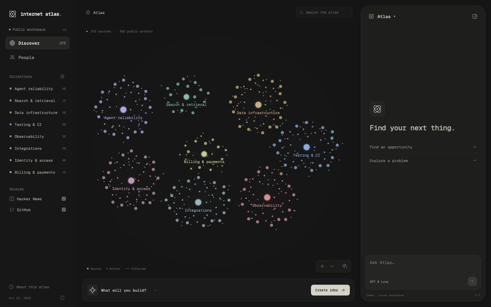

# Internet Atlas

Explore public software problems, shape an idea, find people worth interviewing, and draft the first conversation.

Two linked graphs share one Codex agent. The app runs on your computer at **http://localhost:3000**.



## Run

Requires Node 22+ and the Codex CLI, signed in with your ChatGPT account.

```sh
npm install
codex login
npm run dev
```

Open http://localhost:3000. The agent connects automatically. Use **Connect Codex** to retry if needed. Every model turn uses **GPT 6 Luna**, enforced in the backend. No OpenAI API key is required. Tested with Codex CLI 0.163.0 and its experimental dynamic tool protocol.

```sh
npm test
npm run build
npm start
```

`npm start` serves the production build. Stop a running dev server before starting it on the same port. Optional environment settings are in [.env.example](.env.example). Keep credentials in `.env.local`, which is ignored by Git.

## Use

1. Explore a collection or search the atlas. Select a source to read its original text, author and date. Pin useful evidence.
2. Create your own idea, or ask Atlas to investigate one. Edit the audience, workflow and attached evidence.
3. Choose **Find people**. Each person connects to their supporting sources. Dashed links indicate inferred relevance.
4. Check a public profile, then draft a DM or email. Edit, save, copy or export the result. The app has no send endpoint.

The right agent panel stays with both graphs. It can read the corpus, focus nodes, save an idea, find people, check profiles and save drafts. It does not simulate model responses. Provider errors appear in the conversation. The model can be stopped.

Editing the idea invalidates previous leads and drafts. Drafts are tied to the current idea revision. Saved research can be exported as Markdown.

## Public data and cost

The repository includes a real cached snapshot of **272 public records**, fetched October 22, 2026. The app works without fetching fresh data on startup. Eight collections cover agents, retrieval, data infrastructure, testing, observability, integrations, authentication and billing. Collection selection is curated. The visualization is not a census of the internet.

| Source | Use | Access |
| --- | --- | --- |
| [HN Algolia API](https://hn.algolia.com/api) | Public comments and their original discussion links | Free, no key |
| [Hacker News API](https://github.com/HackerNews/API) | Public bios and source rechecks | Free, no key |
| [GitHub REST API](https://docs.github.com/en/rest) | Public issues and profiles | Free, 60 requests/hour without a token; optional `GITHUB_TOKEN` increases limits |
| [Codex app-server](https://developers.openai.com/codex/app-server) | The local agent, using managed ChatGPT authentication | Uses your existing subscription and its usage limits |

No additional paid service is required. Cline, Parallel and Composio credits are not used. GitHub search has a separate rate limit. Refreshes are paced, cached and surface partial coverage. Failed collections retain their previous records. The refresh button updates the local cache; `npm run ingest` rebuilds the versioned seed.

Sources retain their original URLs, public usernames, dates and retrieval timestamps. Text remains attributable to its original authors. Public profiles may contain self-reported affiliations or email addresses. The app never infers an email from a name or domain.

## How the graph works

The discovery graph contains collection hubs, source records and public authors. Sources are deduplicated by original ID. Multiple records from one author remain separate records and one person. Sparse lexical similarity links connect related sources. The layout uses stable community positions and golden-angle spacing so opening panels does not rearrange the map.

Source size reflects discussion activity; person size reflects attached records. Neither represents market size. Search and lead matching use transparent lexical relevance, collection context and source provenance. Explicit promotion of one's own tool is marked and ranked lower. This is a starting point for investigation, not a trained intent classifier. Relevant authors may be competitors, experts or users. A complaint is not purchase intent.

The agent reads the same records through bounded tools. It can investigate beyond a short excerpt by retrieving the full cached source. Before drafting, it is instructed to check the public profile and refresh supporting evidence. Closed or removed sources are flagged; removed content is redacted locally after a successful recheck. Network failures remain unverified rather than being reported as successful checks.

## Local data and privacy

- `.atlas/` stores your idea, pins, conversation, profiles and drafts. It is ignored by Git.
- The child Codex app-server manages its own authentication. The app does not read or copy OAuth credentials.
- Your requests, current UI context and evidence retrieved by tools are sent to the cloud model. Nothing is sent to outreach recipients.
- The API binds to `127.0.0.1` and checks request hosts and browser origins. It is intended for local, single-user use.
- The child agent uses a read-only sandbox with shell, apps, browser, plugins and subagents disabled. Only Atlas tool requests are serviced by the app.

## Design

Geist Mono, Hugeicons' free Stroke Rounded set, neutral charcoal surfaces, consistent community colors and a tall, inset agent panel. Nested panel corners follow the available padding. Motion is short and reduced-motion preferences are respected.

Graph exploration is inspired by [Graphify](https://github.com/Graphify-Labs/graphify). Interface references include Codex, Cursor, Grok Bot, [Agents with Taste](https://emilkowal.ski/ui/agents-with-taste), [Beautiful UI](https://www.beautifului.dev/), [affectUI](https://www.affectui.com/screens), [OpenUI](https://github.com/thesysdev/openui), [Transitions](https://transitions.dev/) and [React Bits](https://reactbits.dev/). The graph uses `vis-network` and `vis-data`; Graphify's Python pipeline is not a runtime dependency.

## Project map

- `src/`: React interface, graph and agent dock
- `server/data.mjs`: ingestion, cache, search, ideas, lead matching and drafts
- `server/agent.mjs`: Codex JSON-RPC bridge and Atlas tools
- `server/index.mjs`: local API, SSE and web server
- `data/seed.json`: source-linked public snapshot
- `scripts/ingest.mjs`: seed refresh CLI
- `tests/workflow.test.mjs`: provenance, revision invalidation, persistence, origin checks and model enforcement
